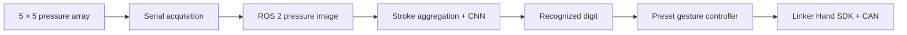

# Tactile Digit Recognition & Dexterous Hand Control

**ROS 2 · PyTorch · 5 × 5 pressure sensing · Linker Hand**

A sensor-to-action prototype developed during my summer research at **HKUST (Guangzhou), 2025**. A pressure array captures tactile input, a CNN recognizes the digit pattern, and a ROS 2 controller commands the corresponding robotic-hand pose.

**[Watch the physical demo →](https://zyc-chenli.github.io/projects/tactile-hand.html)** · [Research portfolio](https://zyc-chenli.github.io)

<a href="https://zyc-chenli.github.io/projects/tactile-hand.html"></a>

## What I built

- **Acquisition:** ROS 2 serial acquisition and pressure-image visualization for a 25-channel sensor array.
- **Recognition:** data collection and a PyTorch CNN that classifies accumulated pressure patterns.
- **Action:** a gesture-control node that maps recognized digits to preset poses using the Linker Hand SDK.

The physical demonstration shows the full pipeline. It is not an accuracy or latency benchmark.

## Pipeline



| Component | Interface / implementation |
| --- | --- |
| Sensor acquisition | Serial, 115200 baud; default `/dev/ttyUSB0` |
| Raw pressure images | `/fsr_array/raw_pressure_image` |
| Pressure visualization | `/fsr_array/pressure_heatmap` |
| CNN | Two convolutional layers, a small fully connected head and dropout |
| Recognition output | `/fsr_array/recognized_digit` (`std_msgs/Int32`) |
| Hand commands | `/cb_right_hand_control_cmd` (`sensor_msgs/JointState`) |

The model has ten output logits (0–9), while the checked-in dataset and physical gesture map cover **digits 1–9**. Digit 0 has no preset hand pose in the current controller.

## Setup

**Development environment:** Ubuntu 24.04 LTS, ROS 2 Jazzy, Python 3.12. ROS 2, `colcon`, serial access and a suitable CAN adapter are prerequisites. This is a hardware project; it does not run as a standalone web demo.

### 1. Get the workspace and device SDK

```bash
git clone https://github.com/zyc-chenli/Linker_Hand-Pressure_sensor.git hand_ws
cd hand_ws

# The recorded SDK directory is a Git link without .gitmodules.
# Obtain the device driver separately in a fresh clone:
git clone https://github.com/linkerbotai/linker_hand_ros2_sdk.git src/linker_hand_ros2_sdk
```

Follow the [vendor SDK instructions](https://github.com/linkerbotai/linker_hand_ros2_sdk) for device dependencies and hand configuration. The workspace references the SDK but does not bundle its full source.

### 2. Prepare Python and build

Use the system Python version associated with ROS 2. Access to system packages is needed for `rclpy` and the ROS message bindings.

```bash
source /opt/ros/jazzy/setup.bash
python3 -m venv --system-site-packages .venv
source .venv/bin/activate
python -m pip install -r requirements.txt

colcon build --symlink-install --packages-select fsr_array_publisher
source install/setup.bash
```

Build the vendor SDK according to its own instructions before starting the hand driver. The optional `finger_sensor_publisher` package is separate from the 5 × 5 pad recognition pipeline.

### 3. Collect data and train

The checked-in `dataset/` contains **481 pressure images across digits 1–9**. Use your own sensor captures and a held-out evaluation for new hardware. The dataset is small and does not establish cross-user performance.

```bash
# In separate terminals, after sourcing ROS and the workspace:
ros2 run fsr_array_publisher fsr_publisher --ros-args -p serial_port:=/dev/ttyUSB0
ros2 run fsr_array_publisher data_collector --ros-args -p start_threshold:=15.0

# Train with the environment's Python:
python train_model_pytorch.py
cp fsr_digit_classifier.pth src/fsr_array_publisher/resource/
colcon build --symlink-install --packages-select fsr_array_publisher
```

No trained checkpoint is bundled. The collector prompts for the target digit; capture multiple examples for each class. The training script uses a stratified 80/20 train–validation split and writes `fsr_digit_classifier.pth`.

### 4. Run the physical pipeline

Set up `can0` and the serial device according to your hardware configuration. The original bench setup used a CAN bitrate of 1,000,000 bit/s.

```bash
# One command per terminal; source ROS, .venv and install/setup.bash first.
ros2 launch linker_hand_ros2_sdk linker_hand.launch.py
ros2 run fsr_array_publisher fsr_publisher

# Explicitly use the environment Python for PyTorch inference:
python install/fsr_array_publisher/lib/fsr_array_publisher/digit_recognizer

ros2 run fsr_array_publisher gesture_controller
```

For the combined launch files:

```bash
ros2 launch fsr_array_publisher hardware_drivers.launch.py
ros2 launch fsr_array_publisher application_logic.launch.py
```

**Local configuration:** `application_logic.launch.py` currently contains a workstation-specific virtual-environment Python path. Change `venv_python_path` to your own path before using that launcher, or use the explicit-Python command above. Generated ROS entry-point shebangs must also point to an interpreter with the required packages; the old `fix_shebang_auto.sh` is a local helper, not a portable setup guarantee.

### Calibration and gesture mapping

- Adjust `serial_port`, `baseline_adc_value`, `max_pressure_adc_value` and `deadzone_offset` in the acquisition node for your sensor.
- Tune the collector and recognizer `start_threshold` values to your sensor noise floor; the examples are not universal calibration values.
- Verify the hand side, joint order and vendor command range before reusing the presets in `gesture_controller_node.py`. The current mapping uses ten position values in the range 0–255.

## Repository layout

```text
src/fsr_array_publisher/       # Acquisition, collection, inference and gesture nodes
src/finger_sensor_publisher/  # Optional finger-pressure visualization package
src/linker_hand_ros2_sdk      # Recorded external SDK Git link
dataset/                     # Small pressure-image dataset, digits 1–9
train_model_pytorch.py        # CNN definition and training loop
requirements.txt             # Python dependency list
```

`main.py` and `setup.sh` are placeholders; the ROS 2 nodes are the application entry points. This repository provides the research prototype, not a fully packaged hardware-independent product.

## Attribution

The hand platform and device driver are provided by [LinkerBot](https://github.com/linkerbotai/linker_hand_ros2_sdk). My contribution is the tactile acquisition, learning and application-control pipeline. The project page includes the original bench demonstration and further context.
